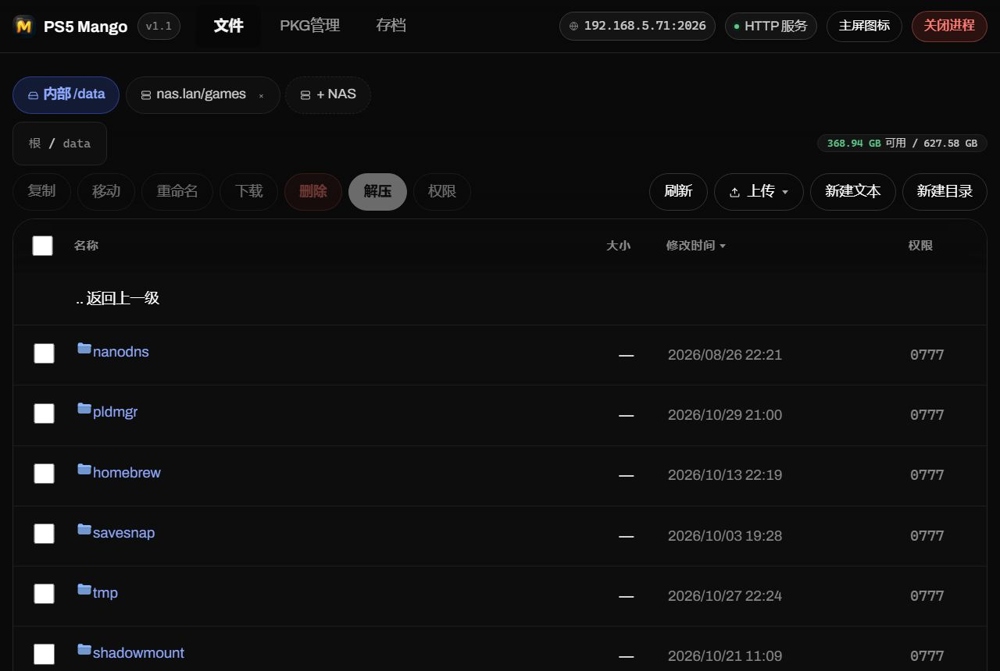
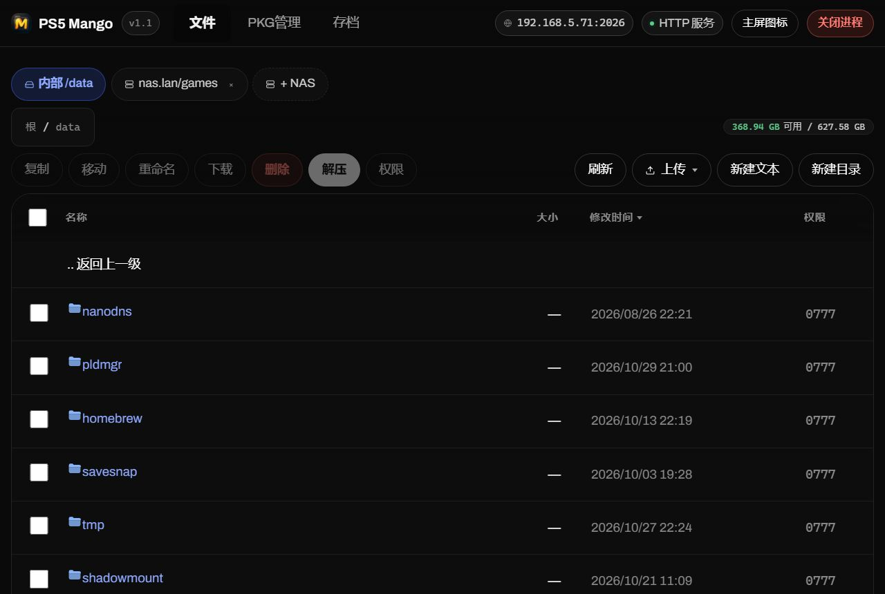
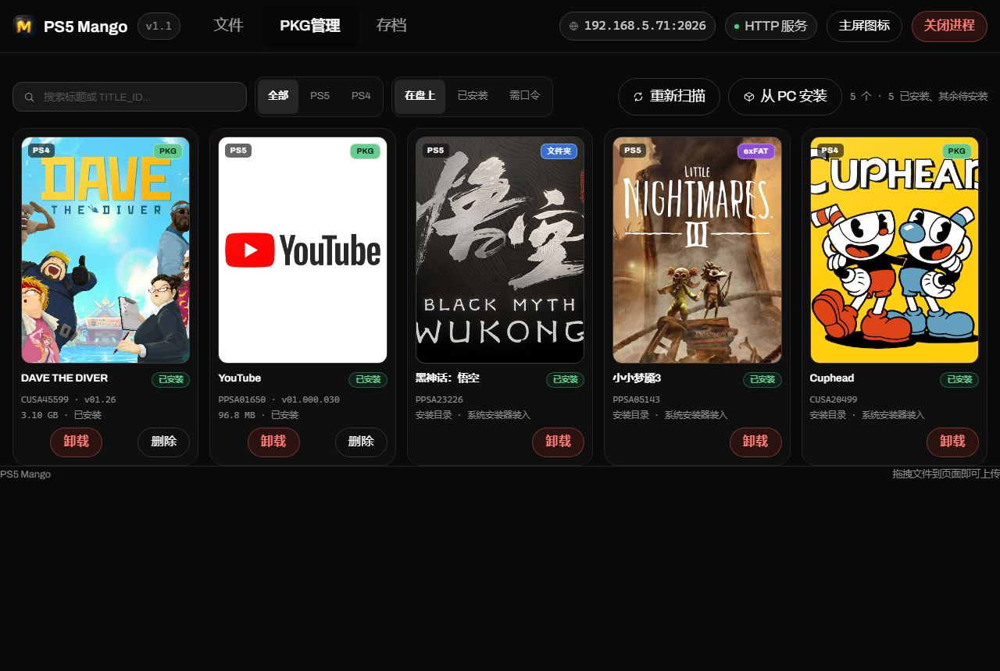
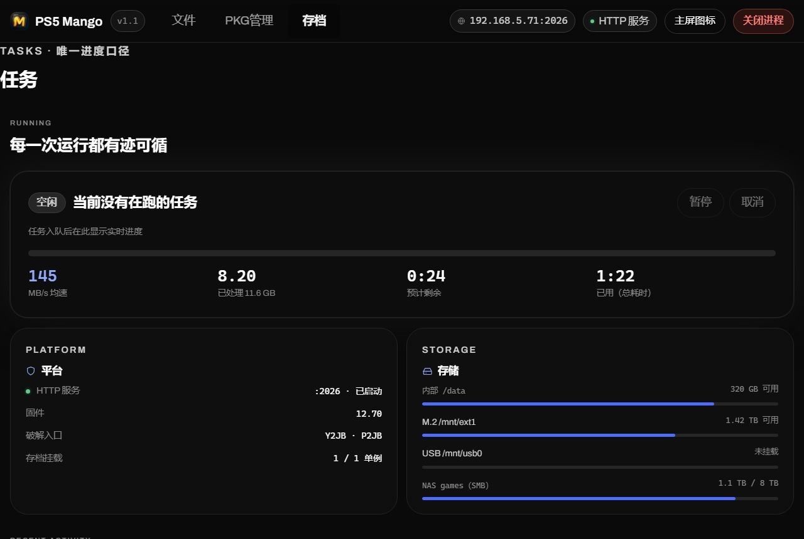

# PS5 Mango

> 中文 | [English](README.en.md)

[](https://github.com/LisherSong/PS5-Mango/releases)
[](LICENSE)
[](https://github.com/LisherSong/PS5-Mango)
[](https://github.com/LisherSong/PS5-Mango)

一个为越狱 PS5 打造的**一体化 Web 控制面板**：在浏览器里管理主机文件、从网络共享拉取/推送文件、解压归档、安装包体，以及备份/还原游戏存档——全部可在同一局域网下的任意设备（或 PS5 自带浏览器）上完成。

**版本：** v1.1

该 payload 把整套前端（HTML/CSS/JS/图形）内嵌进 ELF 并压缩，因此部署只是一个文件，无需额外安装任何东西。

> **版本在哪里显示。** 启动器（以及 etaHEN 的 *plugins / payload ELFs* 菜单）按**文件名**列出 payload，所以版本号刻意放在文件名里：构建产物为 `PS5-Mango-v1.1.elf`。在 Makefile 里改动 `VERSION_TAG` 会重命名产物——这也是主机上唯一能显示的版本标识。payload 还会在启动通知、stdout 以及 `/api/status` 接口中上报版本。

## 截图

下方界面截自真实主机（v1.1，界面为简体中文）：

| 主页 | 文件 |
| --- | --- |
|  |  |
| 游戏库（PKG） | 存档 |
|  |  |



## 功能

### 文件

- 浏览内置存储（`/data`、`/user/data`）、M.2 硬盘（`/mnt/ext1`）与 USB 卷（`/mnt/usb*`），每个存储根目录一键直达。
- 按名称、类型、大小、修改时间或权限排序；选择记忆在浏览器本地存储中。
- 复制、移动、删除、重命名、新建文件夹、新建文本文件；支持多选（带选择栏）。
- 当复制/移动会覆盖文件或合并文件夹时弹出冲突确认。
- 权限列：可逐类编辑读/写/执行，或直接输入经过校验的四位八进制权限。
- 内置 UTF-8 文本编辑器，支持最大 1 MiB 文件，带乐观并发令牌——若保存时文件已被他人改动，会被检出而非静默覆盖。
- 上传单个文件、多个文件或整个文件夹（文件选择器或拖拽）。数据先写入 `.nex-upload-*.tmp`，待字节数匹配后才重命名到位，因此中断的上传绝不会留下一个看似完整却被截断的文件。
- 直接下载单个文件，或将文件夹/多项选择下载为即时生成的 `.tar` 流。
- 工具栏（面包屑 + 操作）在列表滚动时固定在顶栏下方。

### 网络共享（SMB / NFS / WebDAV）

- 通过内置的 [libsmb2](https://github.com/sahlberg/libsmb2) 支持 **SMB2/3**，通过内置的 [libnfs](https://github.com/sahlberg/libnfs) 支持 **NFSv3/v4**。
- 共享以书签形式保存在浏览器中；服务器信息拆成 主机 / 共享 / 路径 / 端口 / 用户 / 密码 分别填写。
- 地址栏接受你手头任何写法——`192.168.1.10/shared`、`192.168.1.10\shared`、`smb://192.168.1.10/shared`、`nfs://192.168.1.10/export`——并在使用前归一化。（Windows 风格的反斜杠在线路两侧都被接受；但 *密码* 中的 `\` 绝不会被改写。）
- 用 `POST /api/fetch` 直接从共享把文件拉进主机存储（可续传，与上传一致）。
- 通过内置的 [mbedTLS](https://github.com/Mbed-TLS/mbedtls) 支持 **WebDAV**，并可打开 **WebDAVS（HTTPS）**。
  PS5 自身即是客户端，直连群晖 / 飞牛 / TrueNAS / Alist / Windows IIS 等 WebDAV 服务端，不经任何中转。
  自签证书可直接连（不校验证书链）；已存在的书签可就地在 HTTP 与 HTTPS 之间切换，不必删了重加。

### 播放

- 直接在页面里播放视频与音频，不必先下载：取流走 `GET /api/fs/raw`，支持 HTTP Range。
- 进度条可拖动（`206 Partial Content`，越界回 `416`），不会从头重放。
- 播放不创建下载任务，因此不会点亮任务坞；视频与音频共用同一个面板。

### 归档

解压覆盖 `.zip`、`.zipx`、`.7z`、`.rar`、`.001`、`.tar`、`.gz`、`.bz2`、`.xz`、`.zst`、`.lzh`、`.cab`、`.cpio`、`.arj`、`.pmd`、`.xar` 以及常见的双后缀（`.tar.gz`、`.tbz2`、`.txz` …），包括加密归档与分卷。

解压**在进程内**完成：payload 自带由 UnRAR（RAR）、LZMA SDK（7z）以及 minizip-ng + zlib（zip/zipx）构建的引擎——无需外部 helper ELF。加密归档（zip/7z/RAR 的 ZipCrypto、AES）直接支持：当归档需要密码时，UI 会向你索取并传给引擎。进度按条目上报，中断的解压可在 payload 重启后续传。分卷可从任意分卷入队——引擎会将其归一化为首卷。

### 包体

- 扫描存储中的包体，以带封面的游戏库形式展示（封面取自包体自身的 `sce_sys/icon0.png`）。
- 无需安装即可读取包体元数据（标题、标题 ID、版本、大小）。
- **fPKG / 已解密的文件夹**：这类没有索尼的安装入口，因此"安装"意味着把它们复制到 `/data/homebrew`，由挂载文件夹类 payload 接管。
- 常规 `.pkg` 文件交给系统安装器，它同时接受本地路径与 `http://` URL 作为包体 URI。
- **从 PC 经局域网直接安装**（`PKG管理 → 从 PC 安装`）：在放有 `.pkg` 文件的文件夹里运行 `tools/serve-pkg.py`，在主机 UI 中输入 PC 地址，再从卡片列表里选择。系统安装器自行下载文件（Range 请求）——包体从不落盘到主机。PC 端服务是一个零依赖的 Python 脚本（改编自 Loopayeh/pkg-sender 的 `serve_pkg.py`，MIT）。不想装 Python 的 Windows 用户可直接从 [GitHub Release](https://github.com/LisherSong/PS5-Mango/releases/latest) 下载 `serve-pkg.exe`（双击即服务当前目录）；插件网页里「从 PC 安装」弹窗底部也有同样的下载入口。

### 存档

- 列出已安装的游戏标题及其存档数据。
- **备份永远先快照。** 还原存档时，会先对当前数据做一份快照再写入；还原失败会自动回滚——不存在"未先存在一份可恢复副本就覆盖存档"的代码路径。快照存放在 `/data/savesnap`（绝不在 `/data/Mango/tmp` 这个存档域临时工作目录内）。

### 任务与诊断

- 每个长耗时操作（拉取、解压、上传、安装、备份、还原、fPKG 复制、删除）都在同一个任务队列中运行，因此进度有单一事实来源，并在发起它的那个视图内联显示。
- 可取消正在运行的任务；已完成的任务上报后随即丢弃。
- `GET /api/diag` 返回请求台账：一个近期请求的环形缓冲，每条带 `done` 标志。若进程在请求中途死在主机上、没有 core dump 可查——最后一条**没有** `done` 记录的条目就是元凶。这正是"页面打开，点一下就崩"这类 bug 的定位方式。
- `GET /api/status` 上报监听端口、主机的局域网地址，以及当前运行的版本。
- `POST /api/shutdown` 停止 payload。PS5 上没有服务管理器，因此没有东西能把它拉起来，Web UI 也随之消亡——故有二次确认。

## 构建

需要 [PS5 payload SDK](https://github.com/ps5-payload-dev/sdk#quick-start)：

```sh
export PS5_PAYLOAD_SDK=/opt/ps5-payload-sdk
make                 # -> PS5-Mango-v1.1.elf
```

`libmicrohttpd` 从 SDK 链接。`make` 会检查它，缺失时运行 `install-libmicrohttpd.sh`；若主机无网络，可指向你自己下载的 tarball
（`LIBMICROHTTPD_TARBALL=/path/to/libmicrohttpd-1.0.1.tar.gz ./install-libmicrohttpd.sh`）。

在 Linux 上做本地 UI 开发——同一套代码，无 PS5 内核调用，含 `/icon0.png` favicon：

```sh
make linux           # -> PS5-Mango-linux-v1.1
./PS5-Mango-linux-v1.1
```

`make NAS=0` 会剔除内置的 SMB/NFS 后端及其库。`make MBTLS=0` 会剔除 mbedTLS，
`webdavs://`（HTTPS）随之不可用，使用时明确报错而不是静默失败。

> ⚠️ 在 Makefile 里改动 `VERSION_TAG` **并且**保持 `$(BIN)` 内的版本号。不在产物名里的版本号在主机上不可见；而只改 `VERSION_TAG` 还会被 `make` 漏掉（编译器 flags 不是任何目标的先决条件）——所以版本号才被刻意设为目标名的一部分。

## 部署

把构建好的 ELF 发给主机上的 ELF 加载器（常用监听端口 `9021`）——或把它丢进某个 payload 管理器的目录：

```sh
export PS5_HOST=ps5_ip_address
nc -q0 "$PS5_HOST" 9021 < PS5-Mango-v1.1.elf
```

主机会弹出带版本号与实际监听端口的通知。然后，从局域网内任意设备打开：

```text
http://<ps5-ip>:2026/
```

payload 监听 `2026`，若该端口被占用则回退到下一个空闲端口——通知与顶栏都会上报真实端口。启动时若缺失，它还会注册一个主屏启动器（标题 ID `MANG88888`，名称 *PS5 Mango*）；UI 也把同一动作作为按钮暴露出来，因为注册它涉及内核，绝不能在游戏运行时自行发生。

再次加载 payload 会替换掉运行中的实例：新进程在绑定前按进程名回收旧进程，因此你最终得到的始终是单一实例、可预期的端口。

## 主机测试

`hosttest.py` 用真实二进制对抗真实 HTTP 客户端与真实 SMB 服务器，演练浏览器实际发出的线路格式：

```sh
python3 hosttest.py                 # 79 条断言，需要一个运行在 :1500 的 smbd fixture
```

辅助脚本位于 `.build/`（见 `.build/build-verify-wsl.sh`）。

主机构建支持几个环境变量，以便把路径与 fixture 从主机实际环境中重定向出去：

| 变量 | 默认值 | 用途 |
| --- | --- | --- |
| `WFM_SAVE_ROOT` | `/user/data`, `/data`, `/mnt/ext1/user/data` | 存档目录探测 |
| `WFM_SNAPSHOT_DIR` | `/data/savesnap` | 存档快照 |
| `WFM_HOMEBREW_DIR` | `/data/homebrew` | fPKG 部署目标 |
| `WFM_DEVICE_ROOT_PREFIX` | `/mnt` | 设备根挂载闸口 |

## 注意事项与限制

- 同一时间只有一个任务。会启动第二个长耗时操作的文件操作，在第一个运行时会被拒绝。
- 删除是递归且永久的；没有回收站。
- 上传与下载在 PS5 自带浏览器中被隐藏——它们本就是给局域网内另一台设备用的。
- 复制/移动的文件在支持 Unix 模式的文件系统上以 `0777` 创建；FAT/exFAT 忽略这一点。模式在创建后设置，否则 umask 会把它们削掉。
- 界面为简体中文与英文双语，文案在 `assets/lang-zh.js` / `assets/lang-en.js`（各 518 条），切换即时生效并记忆在浏览器本地存储中。
- 归档解压在进程内完成（UnRAR / LZMA SDK / minizip-ng，内置在 `third_party/` 下）；不涉及外部 helper payload。
- WebDAV 目前**只读**：可以浏览、播放、复制到本机，但上传 / 新建目录 / 移动改名（`PUT` / `MKCOL` / `MOVE`）尚未实现。
- HTTPS 不校验证书链（自签的群晖/飞牛必须能连），也没有 TOFU 指纹，因此无法抵御中间人。

## 致谢

建立在他人工作之上：

- **[owendswang/ps5-web-file-manager](https://github.com/owendswang/ps5-web-file-manager)** —— 本项目的后端派生自此。GPL-3.0。
- **[ps5-payload-dev/websrv](https://github.com/ps5-payload-dev/websrv)** —— HTTP 服务器结构、静态资产嵌入、PS5 PKG 安装函数。GPL-3.0+。
- **[ps5-payload-dev/ftpsrv](https://github.com/ps5-payload-dev/ftpsrv)** —— payload 约定、主屏启动器/安装流程。GPL-3.0+。
- **[ps5-payload-dev/sdk](https://github.com/ps5-payload-dev/sdk)** —— 构建基础。GPL-3.0+。
- **[libsmb2](https://github.com/sahlberg/libsmb2)** —— SMB2/3 客户端，内置。LGPL-2.1+。
- **[libnfs](https://github.com/sahlberg/libnfs)** —— NFSv3/v4 客户端，内置。LGPL-2.1+（rpcgen 派生的协议文件为 BSD）。
- **[libmicrohttpd](https://www.gnu.org/software/libmicrohttpd/)** —— 嵌入式 HTTP 服务器，从 SDK 链接。LGPL-2.1+。
- **[UnRAR](https://www.rarlab.com/rar_add.htm)** —— RAR 解压（内置，`third_party/unrar7`）。非自由但可再分发许可，仅解压。
- **[7-Zip / LZMA SDK](https://www.7-zip.org/)** —— 7z 解压（内置，`third_party/7z`）。LGPL-2.1+ / unRAR 限制。
- **[minizip-ng](https://github.com/zlib-ng/minizip-ng)** —— zip/zipx 解压含 crypto 后端（内置，`third_party/minizip-ng`）。Zlib 许可。
- **[zlib](https://zlib.net/)** —— DEFLATE（内置，`third_party/zlib`）。Zlib 许可。
- **[n0llptr/Playstation-5-Save-Mounter](https://github.com/n0llptr/Playstation-5-Save-Mounter)** —— `mounter_payload` 关于 `sceFs*` 存档挂载调用顺序的参考。GPL-3.0。尤其它指出 `sceUserServiceInitialize()` 必须在任何 `sceUserService*` 调用之前运行；否则 `sceUserServiceGetForegroundUser()` 会静默地把 id 留在 0，而那个 0 曾被写入存档的 SFO `USER_ID`。
- **[owendswang/wfm-7zip-helper](https://github.com/owendswang/wfm-7zip-helper)** —— 本项目最初采用的 helper-payload 方案；后已被下方进程内引擎取代，感谢指路。
- **[seregonwar/zftpd](https://github.com/seregonwar/zftpd)** —— socket 缓冲区调优参考。MIT。
- **[itsPLK/ps5-payload-manager](https://github.com/itsPLK/ps5-payload-manager)** —— payload 打包参考。GPL-3.0。
- **[etaHEN](https://github.com/etaHEN/etaHEN)** —— 退出前的 ShellUI URI 导航。GPL-3.0。

## 许可证

GPL-3.0-or-later。见 `LICENSE`。

捆绑的第三方库保留各自许可——见 `THIRD_PARTY_NOTICES`。若你分发二进制文件，除本项目的 GPL 之外，还需遵守 libsmb2、libnfs 与 libmicrohttpd 的 LGPL 条款。

PS5、PlayStation 及相关标志是 Sony Interactive Entertainment 的商标。这是非官方的 homebrew，与 Sony 无关联、未获其认可。
